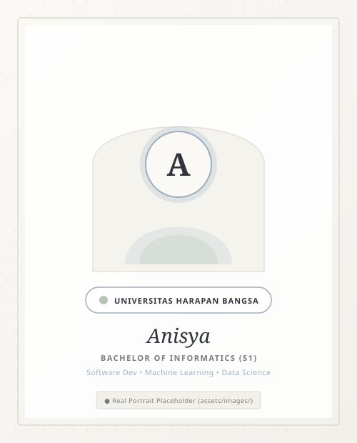

# Anisya — Personal Portfolio & Academic Dossier

> **Live Portfolio for Internship, Job Applications, and International Postgraduate Scholarships**  
> *Undergraduate Informatics Student • Universitas Harapan Bangsa, Indonesia*

---

## 1. Overview & Vision

This repository hosts the personal brand and academic portfolio website of **Anisya**, an undergraduate Informatics student at **Universitas Harapan Bangsa (UHB)**, Indonesia.

The website serves two primary objectives:
1. **Professional Industry Portfolio:** Tailored for software engineering, web/mobile development, machine learning, and IT project management internship and full-time applications.
2. **Academic Research Dossier:** Engineered to meet the rigorous evaluation standards of international master's degree admission committees and prestigious global scholarship reviewers (e.g., LPDP, Erasmus Mundus, Fulbright, MEXT, Chevening, GKS).

---

## 2. Design System: Modern Editorial × Minimalist Corporate

The visual identity embodies an academic journal meets high-end corporate editorial design:

- **Strict Light Mode Palette:** Warm ivory, soft slate, dusty blue, and muted sage.
  - **Background (Primary):** `#FAF9F6` (Warm ivory)
  - **Secondary Background:** `#F1F0EB`
  - **Card Background:** `#FFFFFF`
  - **Primary Text:** `#30343B` (High-contrast slate charcoal)
  - **Secondary Text:** `#777B80` (Balanced editorial grey)
  - **Primary Accent:** `#9BAFC0` (Soft dusty blue)
  - **Secondary Accent:** `#B8C5B5` (Muted sage)
- **Typography:**
  - **Editorial Display Headings:** *Newsreader* (Google Fonts serif with delicate italics)
  - **Clean Modern Body Text:** *Plus Jakarta Sans* (Contemporary, highly legible geometric sans)
  - **Code & Metadata:** System Monospace / *JetBrains Mono*
- **Aesthetic Principles:**
  - Generous whitespace and structured editorial grid.
  - Hairline borders (`1px solid #E8E5DC`) and subtle layered elevation.
  - No dark navy backgrounds, no neon colors, no excessive gradients, and no generic student templates.

---

## 3. Technology Stack

- **HTML5:** Semantic markup, accessibility (ARIA) attributes, and OpenGraph SEO meta tags.
- **CSS3:** Custom properties (CSS variables), responsive flexbox/CSS grid, and editorial typography.
- **JavaScript (Vanilla ES6+):** Lightweight interactivity, scroll-spy, category filter, dynamic modal populator, and clipboard copy.
- **Bootstrap 5.3.3:** Responsive grid, modal component, and offcanvas/navbar collapse.
- **Bootstrap Icons 1.11.3:** Vector iconography.
- **Zero Heavy Dependencies:** Static site ready for instant GitHub Pages deployment with 0 build steps.

---

## 4. Directory Structure

```text
ANISYA-PORTFOLIO/
├── index.html                  # Main portfolio single-page application
├── README.md                   # Project documentation and deployment guide
└── assets/
    ├── css/
    │   └── style.css           # Custom Modern Editorial styling
    ├── js/
    │   └── script.js           # Interactive functionality, modal data & filters
    ├── images/
    │   ├── profile-placeholder.svg      # Editorial profile silhouette & monogram
    │   ├── project-01.svg               # Indonesian Emotion Classification diagram
    │   ├── project-02.svg               # Skincare Recommendation System (SAW + ML)
    │   ├── project-03.svg               # Laundry Management System (REST API)
    │   ├── project-04.svg               # SITUGAS Mobile Reminder (Flutter UI)
    │   ├── project-05.svg               # Library Management System (Laravel)
    │   ├── project-06.svg               # Breast Cancer Classification (WDBC/SMOTE)
    │   └── research-eeg.svg             # Hybrid CNN-LSTM EEG & Pareidolia XAI Pipeline
    └── documents/
        └── CV_Anisya.pdf       # Curriculum Vitae document for direct download
```

---

## 5. Website Sections

| # | Section | Details |
|---|---------|---------|
| **A** | **Home / Hero** | Name, professional headline, dual-track career pillars, primary CTAs (*View Projects*, *Download CV*, *Contact Me*), and editorial profile placeholder. |
| **B** | **About Me** | Exact biographical profile narrative, core competencies, and academic profile snapshot dossier. |
| **C** | **Education** | Universitas Harapan Bangsa (S1 Informatics, 2023–Present) with curriculum areas, and SMA Negeri 1 Bawang (Social Sciences, 2022). |
| **D** | **Technical Skills** | 8 structured categories (Programming, Web Dev, Mobile Dev, Database, Machine Learning, Data Processing, Dev Tools, Design) **without misleading fake percentage bars**. |
| **E** | **Selected Projects** | 6 curated projects with category filtering, SVG technical diagrams, tech stack badges, and interactive "View Details" modal dossiers. |
| **F** | **Professional Experience** | PT Geo Dipa Energi (Persero) – Unit Dieng (Ongoing PMU Internship) and Rocket Chicken (Operations). |
| **G** | **Research Interests** | 6 scholarly focus areas + featured ongoing undergraduate thesis: *"Hybrid CNN-LSTM for EEG Signal Classification and Brain Activity Pattern Identification Using Explainable AI in Face Pareidolia"* on OpenNeuro DS005642. |
| **H** | **Achievements & Activities** | Fest Go World Asia Futurepreneur Selection, Public Speaking, Entrepreneurship, CS Club, Photography, and Choir. |
| **I** | **Contact & Inquiries** | Editable professional contact points (Email with 1-click clipboard copy, GitHub, LinkedIn, Indonesia location), direct message form with mailto generator, and professional closing statement. |

---

## 6. How to Run Locally

You can run the portfolio locally using any static web server:

### Option A: Using Python (Built-in)
Run the following command in the project directory:
```bash
python -m http.server 8000
```
Then open your browser and navigate to `http://localhost:8000`.

### Option B: Using Laragon / Apache
Since the project is inside `c:\laragon\www\ANISYA-PORTFOLIO`, start Laragon and open:
```text
http://anisya-portfolio.test/   or   http://localhost/ANISYA-PORTFOLIO/
```

### Option C: VS Code Live Server
Right-click on `index.html` in Visual Studio Code and select **"Open with Live Server"**.

---

## 7. How to Customize for Anisya

1. **Replace Profile Photo:**
   - Save your professional photo as `profile.jpg` or `profile.png` into `assets/images/`.
   - In `index.html` (around Line 140), change:
     ```html
     
     ```
     to:
     ```html
     
     ```

2. **Replace CV Document:**
   - Place your real PDF resume into `assets/documents/CV_Anisya.pdf`.

3. **Update Contact Details & Links:**
   - In `index.html` (under section `#contact`), update your email address, LinkedIn URL, and GitHub URL.
   - In `assets/js/script.js`, update `recipient = 'your.email@example.com'`.

4. **Add Real Project Screenshots / GitHub Links:**
   - Place screenshots into `assets/images/`.
   - Update repository URLs in `index.html` and `assets/js/script.js`.

---

## 8. Deployment to GitHub Pages

1. Initialize git and commit:
   ```bash
   git init
   git add .
   git commit -m "feat: initial commit of Anisya personal portfolio website"
   ```
2. Create a repository on GitHub (e.g. `anisya-portfolio` or `<your-username>.github.io`).
3. Push to GitHub:
   ```bash
   git remote add origin https://github.com/<your-username>/anisya-portfolio.git
   git branch -M main
   git push -u origin main
   ```
4. In your GitHub repository:
   - Go to **Settings** > **Pages**.
   - Under **Source**, select **Deploy from a branch**.
   - Choose branch **`main`** and folder **`/ (root)`**, then click **Save**.
5. Your website will be live in a few minutes at `https://<your-username>.github.io/anisya-portfolio/`!
